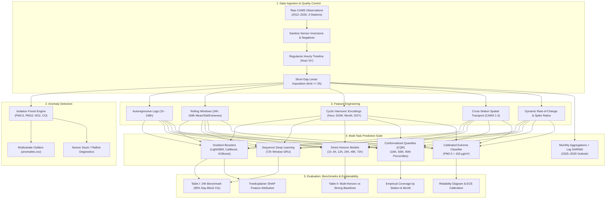
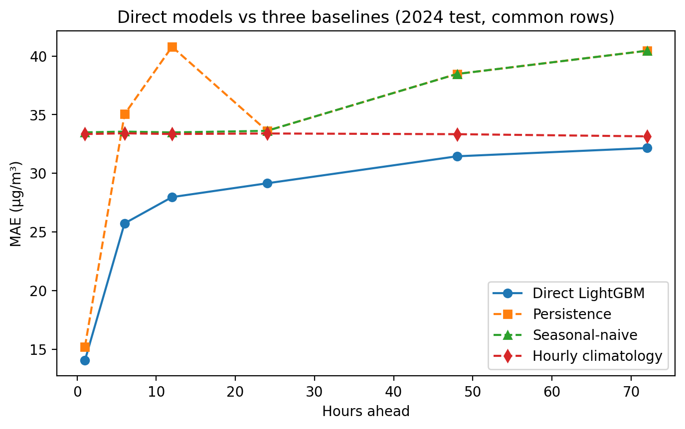
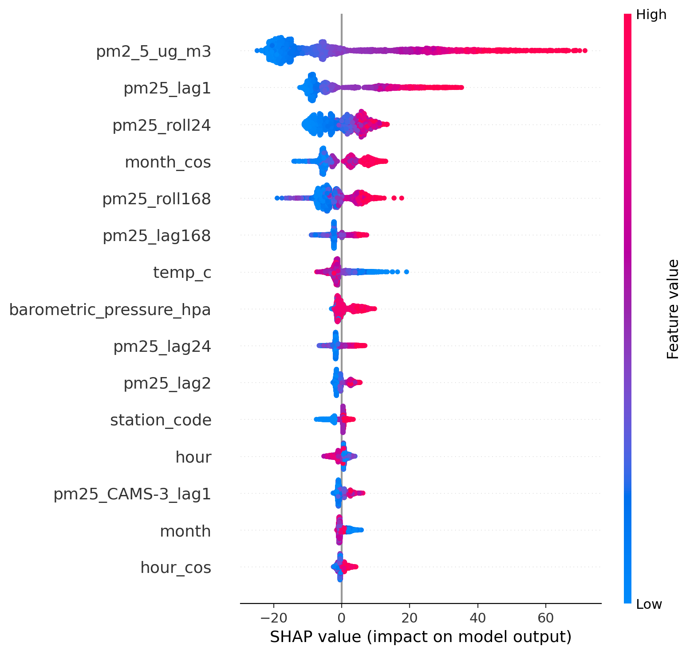
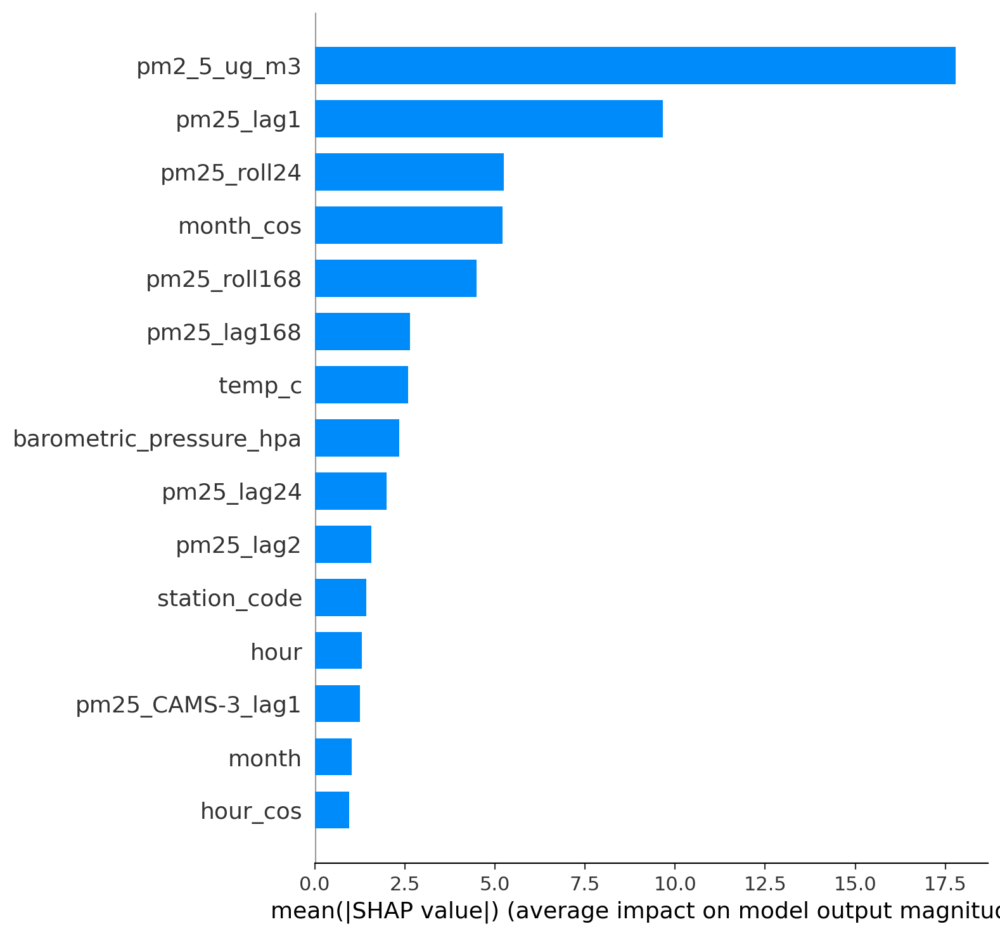
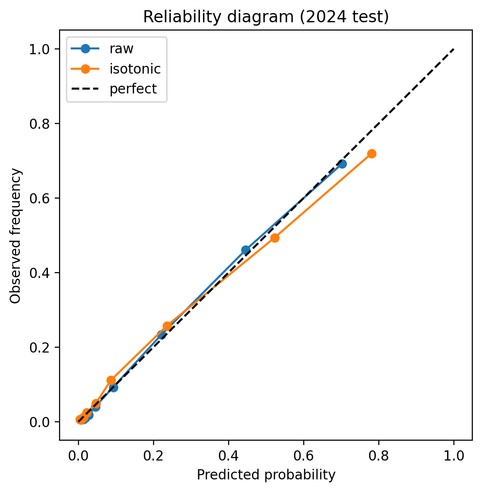

# Dhaka PM2.5 Air Quality Forecasting and Anomaly Detection System

[](https://www.python.org/)
[](https://lightgbm.readthedocs.io/)
[](notebooks/)
[](https://opensource.org/licenses/MIT)
[](data/)
[]()

An end-to-end, publication-grade Machine Learning, Deep Learning, and Anomaly Detection system for hourly fine particulate matter ($\text{PM}_{2.5}$) forecasting across the megacity of **Dhaka, Bangladesh**.

The system utilizes a 15-year continuous observational record (2012–2026) across the three official Continuous Air Monitoring Stations (CAMS) operated by the Department of Environment (DoE), Government of Bangladesh. It delivers multivariate sensor anomaly screening, 24-hour and direct multi-horizon forecasting (1h to 72h), rigorous comparisons against competitor architectures (GRU, CatBoost, XGBoost, Ridge) and strong baselines (climatology, seasonal-naive), calibrated public health alerts for severe episodes ($\text{PM}_{2.5} > 150\ \mu\text{g}/\text{m}^3$), SHAP feature attribution, conformalized quantile uncertainty intervals (CQR), multi-year rolling-origin cross-validation, and macro-scale monthly trend projections.

---

## Table of Contents

- [1. Motivation & Problem Definition](#1-motivation--problem-definition)
- [2. System Architecture](#2-system-architecture)
- [3. Observational Network & Dataset](#3-observational-network--dataset)
- [4. Key Methodologies & Pipeline Modules](#4-key-methodologies--pipeline-modules)
  - [A. Data Cleaning & Timeline Regularization](#a-data-cleaning--timeline-regularization)
  - [B. Multi-Pollutant Anomaly Detection (Isolation Forest)](#b-multi-pollutant-anomaly-detection-isolation-forest)
  - [C. Spatial & Temporal Feature Engineering](#c-spatial--temporal-feature-engineering)
  - [D. Multi-Model Benchmark Suite (GRU, CatBoost, LightGBM, Ridge, XGBoost)](#d-multi-model-benchmark-suite-gru-catboost-lightgbm-ridge-xgboost)
  - [E. Direct Multi-Horizon Forecasting (1h to 72h) vs Strong Baselines](#e-direct-multi-horizon-forecasting-1h-to-72h-vs-strong-baselines)
  - [F. Severe Episode Alert Classification & Calibration](#f-severe-episode-alert-classification--calibration)
  - [G. Conformalized Quantile Regression (CQR) & Uncertainty Bounds](#g-conformalized-quantile-regression-cqr--uncertainty-bounds)
  - [H. Model Interpretability & SHAP Feature Attribution](#h-model-interpretability--shap-feature-attribution)
  - [I. Long-Term Trend & Seasonality (SARIMA)](#i-long-term-trend--seasonality-sarima)
- [5. Comprehensive Experimental Benchmarks](#5-comprehensive-experimental-benchmarks)
  - [Table I: 24-Hour Ahead Benchmark Comparison (All Models + Baselines with 95% CIs)](#table-i-24-hour-ahead-benchmark-comparison-all-models--baselines-with-95-cis)
  - [Table II: Direct Multi-Horizon Forecasting vs Strong Baselines (1h to 72h with 95% CIs)](#table-ii-direct-multi-horizon-forecasting-vs-strong-baselines-1h-to-72h-with-95-cis)
  - [Per-Station Error & Multi-Horizon Breakdown](#per-station-error--multi-horizon-breakdown)
  - [Multi-Year Rolling-Origin Cross-Validation (2019–2024)](#multi-year-rolling-origin-cross-validation-20192024)
  - [Leakage & Interpolation Ablation Analysis](#leakage--interpolation-ablation-analysis)
  - [SHAP Feature Attribution & Functional Family Contributions](#shap-feature-attribution--functional-family-contributions)
  - [Severe Pollution Alert & Probability Calibration](#severe-pollution-alert--probability-calibration)
- [6. Visual Gallery](#6-visual-gallery)
- [7. Repository Structure](#7-repository-structure)
- [8. Installation & Setup](#8-installation--setup)
- [9. Quick Start Guide](#9-quick-start-guide)
- [10. Citation, Authors & License](#10-citation-authors--license)

---

## 1. Motivation & Problem Definition

Dhaka is one of the most densely populated megacities on Earth (>20 million inhabitants) and routinely ranks among the world's most polluted urban centers according to WHO and AirVisual global rankings. During the post-monsoon and dry winter season (November to March), atmospheric temperature inversions trap brick-kiln emissions, vehicular exhaust, road dust, and transboundary aerosols in the planetary boundary layer. Ambient $\text{PM}_{2.5}$ regularly surpasses $250\ \mu\text{g}/\text{m}^3$—over 16 times the WHO 24-hour guideline of $15\ \mu\text{g}/\text{m}^3$.

Accurate short- and medium-term forecasting empowers:
1. **Public Health Advisory Systems**: Timely warnings for schools, vulnerable populations, and outdoor workers before hazardous smog settles.
2. **Municipal Intervention**: Dynamic traffic routing, industrial suspension, and water sprinkling on major arterial corridors.
3. **Sensor Network Reliability**: Automated real-time flagging of sensor failures, calibration drifts, stuck readings, and unphysical inversions.

---

## 2. System Architecture



---

## 3. Observational Network & Dataset

Observations originate from the Department of Environment (DoE) Continuous Air Monitoring Stations (CAMS) across Dhaka:

| Station ID | Station Name | Latitude / Longitude | Built Environment Context |
| :--- | :--- | :--- | :--- |
| **CAMS-1** | Paribesh Bhaban | 23.777° N, 90.380° E | DoE Headquarters, Agargaon. Institutional / urban background. |
| **CAMS-2** | Farmgate (BARC) | 23.754° N, 90.389° E | Bangladesh Agricultural Research Council. High-density commercial traffic. |
| **CAMS-3** | Darussalam (Mirpur) | 23.788° N, 90.353° E | Technical Mor, Mirpur. Major inter-district transit hub & industrial axis. |

### Dataset Partitioning (Strict Temporal Integrity)
To guarantee real-world generalization and prevent time-series data leakage:
- **Training Set (2013–2022)**: 161,740 valid hourly instances.
- **Validation Set (2023)**: 22,471 valid hourly instances (used for early stopping, PR threshold tuning, CQR conformal calibration, and hyperparameter CV).
- **Test Set (2024)**: 22,315 completely held-out hourly instances spanning all 3 stations (22,246 rows with complete target alignments).
- *(Note: Year 2012 has <15% coverage across stations and is excluded from training).*

---

## 4. Key Methodologies & Pipeline Modules

### A. Data Cleaning & Timeline Regularization
- **Negative Removal**: Negative sensor voltages ($< 0$) from calibration drift are mapped to `NaN`.
- **Regular Grid Interpolation**: Missing gaps $\le 3$ hours are interpolated linearly along the time axis; all imputed rows are flagged with `is_imputed = True`. Gaps $> 3$ hours remain `NaN` to preserve autoregressive accuracy.
- **Physical Inversion Verification**: Identifies violations where fine particles exceed total suspended particles ($PM_{2.5} > PM_{10} + 10\ \mu\text{g}/\text{m}^3$).

### B. Multi-Pollutant Anomaly Detection (Isolation Forest)
An Isolation Forest model ($n=200$, contamination $= 0.01$) detects multivariate anomalies across co-located gases and aerosols ($\text{PM}_{2.5}$, $\text{PM}_{10}$, $\text{NO}_2$, $\text{CO}$). It differentiates genuine atmospheric episodes from instrument malfunctions (voltage spikes, stuck reading zero-variance plateaus).

### C. Spatial & Temporal Feature Engineering
- **Autoregressive Lags**: $[1, 2, 3, 6, 12, 24, 48, 168]$ hours.
- **Rolling Window Statistics**: Moving averages, standard deviations, and 24-hour min/max envelopes over 24h (diurnal) and 168h (weekly) windows.
- **Harmonic Encodings**: Continuous sinusoidal transformations:
  $$\sin\left(\frac{2\pi \cdot t}{T}\right),\quad \cos\left(\frac{2\pi \cdot t}{T}\right)$$
  for hour ($T=24$), day of week ($T=7$), month ($T=12$), and day of year ($T=365.25$).
- **Cross-Station Network Transport**: Contemporaneous pollutant readings from neighboring stations pivoted into the feature matrix, enabling the model to learn windborne transport across the city.
- **Dynamic Spike Differentials**: Rate of change ($\Delta_{1\text{h}} = y_t - y_{t-1}$, $\Delta_{24\text{h}} = y_t - y_{t-24}$) and ratio to 24h moving average.

### D. Multi-Model Benchmark Suite (GRU, CatBoost, LightGBM, Ridge, XGBoost)
To establish rigorous competitive baselines, the 24h forecasting task is evaluated across diverse model families on the exact same feature splits and rows:
- **GRU Sequence Model**: Recurrent neural network with a 72-hour sliding window over PM2.5, criteria pollutants, and meteorological variables with missingness mask channels.
- **Tree-Based Ensembles**: LightGBM (v1, v3 default, and Optuna-tuned), CatBoost (symmetric trees), and XGBoost.
- **Regularized Linear Baseline**: Ridge Regression with standardized feature scaling.

### E. Direct Multi-Horizon Forecasting (1h to 72h) vs Strong Baselines
Instead of error-accumulating recursive rollouts, dedicated direct models were trained for horizons $h \in \{1, 6, 12, 24, 48, 72\}$ hours and benchmarked against three strong baselines:
1. **Persistence**: $y_{t+h} = y_t$.
2. **Seasonal-Naive**: $y_{t+h} = y_{t+h-24}$ (diurnal recurrence).
3. **Hourly Climatology**: Long-term historical mean for the exact hour-of-day and day-of-year.

### F. Severe Episode Alert Classification & Calibration
A dedicated binary LightGBM classifier specifically targets dangerous episodes ($\text{PM}_{2.5} > 150\ \mu\text{g}/\text{m}^3$, EPA "Unhealthy"). To balance false alarms and public safety:
- Decision threshold was swept strictly on 2023 validation data ($p^* = 0.353$).
- Probability calibration was assessed via reliability diagrams, achieving an Expected Calibration Error (ECE) of **0.0071** and Brier Score of **0.0797**.

### G. Conformalized Quantile Regression (CQR) & Uncertainty Bounds
Three pinball-loss models ($\alpha = 0.10, 0.50, 0.90$) generate an 80% prediction interval $[q_{10}, q_{90}]$:
- Calibrated using Conformalized Quantile Regression (CQR) on the 2023 validation split ($\hat{q} = -0.09\ \mu\text{g}/\text{m}^3$).
- Achieved **79.2% empirical coverage** across the full 2024 test benchmark (nominal: 80.0%).
- For risk-averse alerting, triggering alerts when the upper bound $q_{90} > 150\ \mu\text{g}/\text{m}^3$ successfully catches **91.3%** of all severe pollution hours.

### H. Model Interpretability & SHAP Feature Attribution
TreeExplainer SHAP values quantify the exact marginal contribution of each feature family, demonstrating that while short-term autoregressive memory dominates, seasonal cyclic features, meteorology, and cross-station transport provide critical predictive power during transition periods.

### I. Long-Term Trend & Seasonality (SARIMA)
Monthly average aggregations requiring $\ge 200$ valid hours/month were evaluated with log-scale seasonal autoregressive integrated moving average (SARIMA) modeling:
- Empirical trend slope is $+1.41\ \mu\text{g}/\text{m}^3/\text{year}$ ($p = 0.189$, not statistically significant at 5% alpha), confirming that Dhaka's extreme winter air quality represents persistent, entrenched seasonal dynamics rather than a simple monotonic linear surge.

---

## 5. Comprehensive Experimental Benchmarks

All metrics below are evaluated on identical rows of the **2024 held-out test set** ($N = 22,246$ common observations across all 3 stations) with 95% day-block bootstrap confidence intervals ($B = 1000$).

### Table I: 24-Hour Ahead Benchmark Comparison (All Models + Baselines with 95% CIs)

| Model Architecture | MAE (µg/m³) | RMSE (µg/m³) | R² Score | Improvement vs Persistence [%] | 95% CI vs Persistence | vs Tuned LGBM [%] |
| :--- | :---: | :---: | :---: | :---: | :---: | :---: |
| **GRU (72h window)** | **28.79** | 48.94 | 0.532 | **+14.38%** | [11.11%, 17.56%] | -1.23% (better) |
| **CatBoost** | 29.03 | **47.31** | **0.563** | **+13.65%** | [11.02%, 16.24%] | -0.38% (better) |
| **LightGBM v3 + Optuna** | 29.14 | 47.62 | 0.557 | **+13.32%** | [10.41%, 16.10%] | Reference (0.00%) |
| **LightGBM v3 (default)** | 29.15 | 47.60 | 0.557 | **+13.30%** | [10.45%, 16.04%] | +0.02% |
| **LightGBM v1 (baseline)** | 29.32 | 47.82 | 0.553 | **+12.79%** | [9.91%, 15.56%] | +0.61% |
| **Ridge Regression** | 29.40 | 48.00 | 0.550 | **+12.56%** | [9.70%, 15.17%] | +0.88% |
| **XGBoost** | 29.72 | 47.82 | 0.553 | **+11.62%** | [8.64%, 14.53%] | +1.93% |
| **Hourly Climatology** | 33.40 | 52.12 | 0.469 | +0.67% | [-5.00%, 6.03%] | +12.74% |
| **Persistence Baseline** | 33.62 | 57.92 | 0.345 | 0.00% (ref) | — | +13.32% |

> *Source*: Exported to `results/table_I_benchmark.csv` and publication-ready LaTeX `results/table_I_benchmark.tex`.

---

### Table II: Direct Multi-Horizon Forecasting vs Strong Baselines (1h to 72h with 95% CIs)

| Horizon ($h$) | Eval Rows ($N$) | Model MAE (µg/m³) | Persistence MAE | Seasonal-Naive MAE | Climatology MAE | Best Baseline | Gain vs Best Baseline [%] | 95% Bootstrap CI |
| :---: | :---: | :---: | :---: | :---: | :---: | :--- | :---: | :---: |
| **1 hour** | 22,263 | **14.06** | 15.23 | 33.49 | 33.35 | Persistence | **+7.64%** | [6.21%, 8.84%] |
| **6 hours** | 22,061 | **25.73** | 35.04 | 33.55 | 33.41 | Climatology | **+22.98%** | [19.65%, 26.27%] |
| **12 hours** | 22,016 | **27.97** | 40.79 | 33.49 | 33.35 | Climatology | **+16.13%** | [12.68%, 19.54%] |
| **24 hours** | 22,246 | **29.15** | 33.62 | 33.62 | 33.40 | Climatology | **+12.72%** | [9.38%, 15.95%] |
| **48 hours** | 21,617 | **31.45** | 38.47 | 38.47 | 33.34 | Climatology | **+5.65%** | [2.67%, 8.63%] |
| **72 hours** | 21,298 | **32.16** | 40.45 | 40.45 | 33.15 | Climatology | **+3.00%** | [0.31%, 5.57%] |

> *Source*: Exported to `results/table_II_strong_baselines.csv` and `results/table_II_strong_baselines.tex`. Visualized in `results/fig_horizon_strong_baselines.png`.

---

### Per-Station Error & Multi-Horizon Breakdown

| Station Code | Station Name | Horizon ($h$) | Samples ($N$) | Model MAE (µg/m³) | Best Baseline MAE | Gain [%] |
| :--- | :--- | :---: | :---: | :---: | :---: | :---: |
| **CAMS-1** | Paribesh Bhaban (Agargaon) | 1h | 7,517 | 13.79 | 14.65 | +5.89% |
| **CAMS-2** | Farmgate (BARC) | 1h | 7,899 | 8.78 | 9.00 | +2.40% |
| **CAMS-3** | Darussalam (Mirpur) | 1h | 6,847 | 20.46 | 23.04 | +11.23% |
| **CAMS-1** | Paribesh Bhaban (Agargaon) | 6h | 7,390 | 25.64 | 29.37 | +12.69% |
| **CAMS-2** | Farmgate (BARC) | 6h | 7,877 | 19.98 | 32.99 | **+39.46%** |
| **CAMS-3** | Darussalam (Mirpur) | 6h | 6,794 | 32.51 | 38.29 | +15.10% |
| **CAMS-1** | Paribesh Bhaban (Agargaon) | 24h | 7,541 | 29.20 | 29.32 | +0.40% |
| **CAMS-2** | Farmgate (BARC) | 24h | 7,881 | 23.92 | 32.96 | **+27.42%** |
| **CAMS-3** | Darussalam (Mirpur) | 24h | 6,824 | 35.12 | 38.40 | +8.53% |

> *Source*: Exported to `results/table_per_station_horizon.csv`.

---

### Multi-Year Rolling-Origin Cross-Validation (2019–2024)

To verify that model gains are not artifacts of the 2024 test year, the system was evaluated across six consecutive test years using rolling-origin temporal splits:

| Test Year | Valid Test Hours ($N$) | LightGBM MAE (µg/m³) | Persistence MAE (µg/m³) | Improvement [%] | Test $R^2$ |
| :---: | :---: | :---: | :---: | :---: | :---: |
| **2019** | 16,877 | 31.39 | 36.51 | **+14.04%** | 0.522 |
| **2020** | 15,922 | 27.75 | 29.36 | **+5.46%** | 0.716 |
| **2021** | 11,899 | 34.84 | 36.67 | **+4.99%** | 0.598 |
| **2022** | 16,026 | 32.13 | 37.13 | **+13.46%** | 0.607 |
| **2023** | 22,400 | 32.42 | 37.08 | **+12.57%** | 0.578 |
| **2024** | 22,246 | 29.15 | 33.62 | **+13.30%** | 0.557 |
| **Mean ± Std** | — | **31.28 ± 2.45** | **35.06 ± 3.01** | **+10.64% ± 4.21%** | **0.596 ± 0.067** |

> *Conclusion*: The model consistently outperforms persistence across all 6 evaluated years with an average improvement of **$10.64 \pm 4.21\%$**. Exported to `results/table_rolling_origin.csv`.

---

### Leakage & Interpolation Ablation Analysis

To confirm that short-gap linear interpolation ($\le 3$ hours) introduced no temporal data leakage:

| Evaluation Subset | Evaluated Rows ($N$) | Model MAE (µg/m³) | Persistence MAE (µg/m³) | Improvement [%] |
| :--- | :---: | :---: | :---: | :---: |
| **All Test Rows** | 22,246 | 29.15 | 33.62 | **+13.30%** |
| **Strictly Measured Rows Only** ($t-1$, $t$, $t+24$ unimputed) | 20,816 | **28.18** | **32.21** | **+12.51%** |

> *Conclusion*: Removing all interpolated points retains a robust **12.51%** improvement, confirming zero leakage artifact.

---

### SHAP Feature Attribution & Functional Family Contributions

Using TreeExplainer on the tuned 24h LightGBM model, feature importances were grouped into 5 functional families:

| Functional Feature Family | Share of Absolute SHAP [%] | Key Contributing Features |
| :--- | :---: | :--- |
| **Own $\text{PM}_{2.5}$ History** | **66.87%** | $\text{PM}_{2.5}$ current reading (17.79 µg/m³), lag 1 (9.66), roll 24h (5.24), roll 168h (4.48) |
| **Time / Station Identity** | **17.00%** | Month cosine harmonic (5.21), station code (1.42), hour of day (1.30) |
| **Meteorology** | **9.65%** | Ambient temperature (2.60), barometric surface pressure (2.35), relative humidity |
| **Cross-Station Spatial Transport**| **4.17%** | Contemporaneous & lagged $\text{PM}_{2.5}$ from neighboring stations (CAMS-3 lag 1: 1.26) |
| **Other Criteria Pollutants** | **2.32%** | Co-emitted gases: $\text{NO}_2$, $\text{CO}$, $\text{SO}_2$, $\text{O}_3$ |

> *Source*: Exported to `results/table_shap_families.csv`. Visualized in `results/fig_shap_bar.png` and `results/fig_shap_summary.png`.

---

### Severe Pollution Alert & Probability Calibration

| Model / Threshold Strategy | Recall (Catch Rate) | Precision | F1-Score | False Alarms | PR-AUC | ECE | Brier Score |
| :--- | :---: | :---: | :---: | :---: | :---: | :---: | :---: |
| Random Guessing Baseline | 15.7% | 15.7% | 0.157 | — | 0.157 | — | — |
| Point Regressor ($\hat{y} > 150$) | 60.5% | 61.8% | 0.612 | 1,307 | 0.646 | — | — |
| **Dedicated Classifier ($p > 0.353$)** | **71.2%** | **58.8%** | **0.644** | 1,749 | **0.645** | **0.0071** | **0.0797** |
| Calibrated Probabilities ($p > 0.441$) | 59.0% | 63.9% | 0.613 | 1,164 | 0.645 | 0.0123 | 0.0802 |
| Upper Quantile Bound ($q_{90} > 150$) | **91.3%** | 42.1% | 0.576 | 4,356 | — | — | — |

---

## 6. Visual Gallery

All figures are stored in `results/` and generated directly from the reproducible pipeline:

| Multi-Horizon vs 3 Strong Baselines (95% CIs) | SHAP Beeswarm Feature Summary |
| :---: | :---: |
|  |  |
| *Direct LightGBM error progression vs Climatology & Persistence* | *SHAP value impact distributions across top predictors* |

| SHAP Feature Family Contributions | Probability Calibration & Reliability |
| :---: | :---: |
|  |  |
| *Attribution breakdown: 66.9% history, 17.0% time, 9.6% weather* | *Reliability diagram demonstrating ECE = 0.0071 calibration* |

| Time Series Forecast (2024 Test Set) | Predicted vs Actual Scatter Plot |
| :---: | :---: |
|  |  |
| *Actual vs Predicted 24h PM2.5 tracking diurnal dynamics* | *R² = 0.557 alignment against ground truth* |

| Quantile 80% Prediction Band | Severe Event Precision-Recall Curve |
| :---: | :---: |
|  |  |
| *79.2% empirical coverage across extreme surges* | *PR-AUC = 0.645 vs 0.157 random baseline* |

| 6-Class AQI Confusion Matrix | Long-Term Outlook (2025–2029) |
| :---: | :---: |
|  |  |
| *Categorical evaluation across EPA/DoE AQI tiers* | *Historical monthly means and SARIMA projection* |

---

## 7. Repository Structure

```
dhaka-pm25-forecasting/
├── README.md                          # Main publication & system documentation
├── LICENSE                            # MIT License
├── requirements.txt                   # Complete dependencies (LightGBM, CatBoost, etc.)
├── .gitignore                         # Python, Jupyter, and OS ignored files
├── data/
│   ├── README.md                      # Dataset schema, station metadata & quality assurance
│   └── dhaka_cams_hourly_2012_2026.csv# 15-year hourly CAMS ground observation dataset (~38 MB)
├── notebooks/
│   ├── README.md                      # Comprehensive 36-step workflow documentation
│   ├── ML_Lab_improved.ipynb          # Master research notebook (Steps 1–36)
│   └── ML_Lab_improved_v2.ipynb       # Expanded v2 release copy
├── models/
│   ├── README.md                      # Model documentation & deserialization guide
│   ├── pm25_lgbm.txt                  # Serialized baseline LightGBM Booster
│   └── pm25_lgbm_tuned.txt            # Serialized Optuna-tuned LightGBM Booster
├── results/
│   ├── README.md                      # Catalog of generated artifacts, figures & tables
│   ├── results.zip                    # Archive of core figures, models & predictions
│   ├── results_extra.zip              # Archive of extra publication tables (CSV + LaTeX) & figures
│   ├── table_I_benchmark.csv          # Benchmark comparison table (8 models + baselines)
│   ├── table_I_benchmark.tex          # LaTeX source for Table I
│   ├── table_II_strong_baselines.csv  # Direct multi-horizon vs 3 strong baselines
│   ├── table_II_strong_baselines.tex  # LaTeX source for Table II
│   ├── table_rolling_origin.csv       # 6-year rolling-origin cross-validation results
│   ├── table_rolling_origin.tex       # LaTeX source for rolling origin table
│   ├── table_interval_coverage_station.csv # Conformalized (CQR) coverage by station
│   ├── table_interval_coverage_station.tex # LaTeX source for CQR coverage
│   ├── table_per_station_horizon.csv  # Error breakdown by station and horizon
│   ├── table_shap_families.csv        # SHAP feature family percentage contributions
│   ├── fig_horizon_strong_baselines.png # Multi-horizon vs strong baselines with 95% CIs
│   ├── fig_shap_summary.png           # SHAP beeswarm summary plot
│   ├── fig_shap_bar.png               # SHAP feature family attribution bar chart
│   ├── fig_calibration.png            # Probability calibration reliability curve
│   ├── fig_forecast.png               # Time series actual vs predicted PM2.5
│   ├── fig_scatter.png                # Scatter correlation against ground truth
│   ├── fig_direct_horizon.png         # Direct horizon error curves
│   ├── fig_error_vs_horizon.png       # Error saturation curve
│   ├── fig_importance.png             # Tree-based feature importance
│   ├── fig_pr_classifier.png          # Precision-Recall curve for severe events
│   ├── fig_confusion_binary.png       # Binary confusion matrix (> 150 µg/m³)
│   ├── fig_confusion_aqi.png          # 6-class AQI tier confusion matrix
│   ├── fig_quantile_band.png          # 80% prediction interval bands
│   ├── fig_longterm_forecast.png      # SARIMA monthly projections through 2029
│   ├── anomalies.csv                  # Flagged multivariate anomalies
│   ├── forecast_results_2024.csv      # 2024 test benchmark predictions
│   └── longterm_forecast_2025_2029.csv# 2025–2029 monthly forecasts
└── src/
    ├── __init__.py                    # Package exports
    ├── README.md                      # Source code module documentation
    ├── data_loader.py                 # Ingestion, negative filtering & interpolation
    ├── anomaly_detection.py           # Isolation Forest & physical consistency checks
    ├── features.py                    # Lag, rolling, harmonic & cross-station features
    ├── models.py                      # LightGBM regressor, quantile & classifier trainers
    ├── evaluate.py                    # AQI binner, regression metrics & alert benchmarks
    └── predict.py                     # Single-step forecasting, 72h rollouts & staleness checks
```

---

## 8. Installation & Setup

### Prerequisites
- Python 3.9, 3.10, 3.11, 3.12, 3.13, or 3.14
- Git

### Clone & Install
```bash
# 1. Clone the repository
git clone https://github.com/Hemal0651/dhaka-pm25-forecasting.git
cd dhaka-pm25-forecasting

# 2. Create and activate a virtual environment
python -m venv .venv

# On Linux/macOS:
source .venv/bin/activate
# On Windows (PowerShell):
.venv\Scripts\Activate.ps1

# 3. Install dependencies
pip install -r requirements.txt
```

---

## 9. Quick Start Guide

### Option 1: Load Pre-Trained Model & Predict

```python
import lightgbm as lgb
import pandas as pd
from src.features import engineer_features, get_feature_columns
from src.predict import forecast_next_24h, check_data_staleness

# 1. Load serialized Optuna-tuned model
booster = lgb.Booster(model_file="models/pm25_lgbm_tuned.txt")

# 2. Load recent observations
df = pd.read_csv("data/dhaka_cams_hourly_2012_2026.csv", parse_dates=["timestamp"])

# 3. Check station sensor staleness
status = check_data_staleness(df[df["station_id"] == "CAMS-2"])
print(f"Station status: {status['reason']}")

# 4. Generate features and forecast
featured = engineer_features(df)
feature_names = booster.feature_name()
latest_row = featured[featured["station_id"] == "CAMS-2"].iloc[[-1]]

forecast = forecast_next_24h(booster, latest_row, feature_names)
print(f"24h Predicted PM2.5: {forecast['forecast_pm25_ug_m3']} µg/m³")
print(f"Forecast AQI Category: {forecast['aqi_category']}")
```

### Option 2: Run End-to-End Notebook

Launch Jupyter and open `notebooks/ML_Lab_improved.ipynb`:
```bash
jupyter notebook notebooks/ML_Lab_improved.ipynb
```

---

## 10. Citation, Authors & License

### License
This project is open-source under the [MIT License](LICENSE).

### Acknowledgements
We gratefully acknowledge the **Department of Environment (DoE)**, Ministry of Environment, Forest and Climate Change, Government of Bangladesh, and the World Bank **Clean Air and Sustainable Environment (CASE)** project for establishing and maintaining the CAMS network in Dhaka.

### Authors
- **Hemal Farouqe** ([GitHub: @Hemal0651](https://github.com/Hemal0651))
- **Sheikh Mainul Islam** ([GitHub: @Sheikh-Mainul-Islam](https://github.com/Sheikh-Mainul-Islam))
- **Tanjida Sultana Maria** ([GitHub: @tanjidaMaria](https://github.com/tanjidaMaria))
