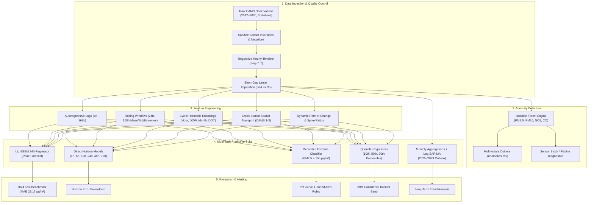
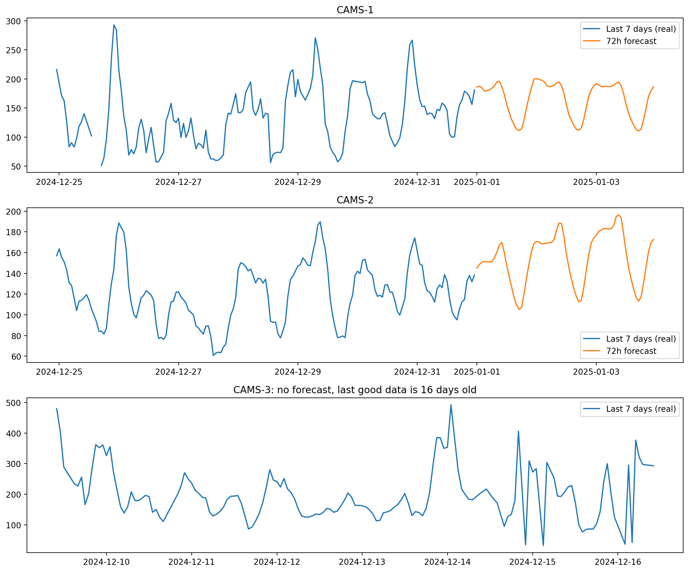
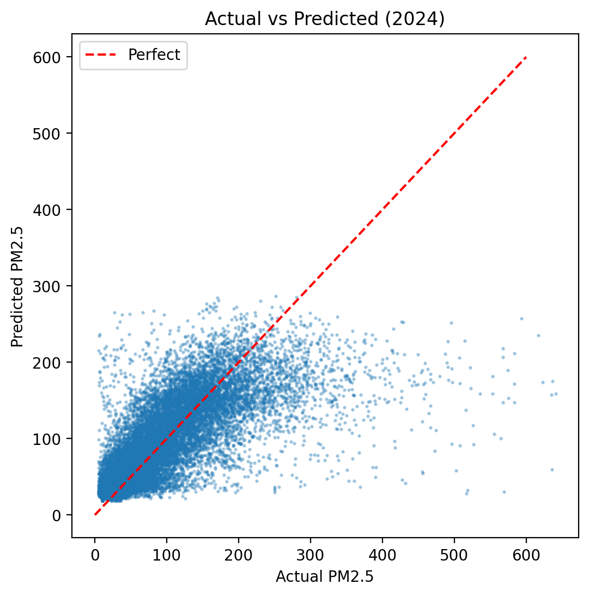
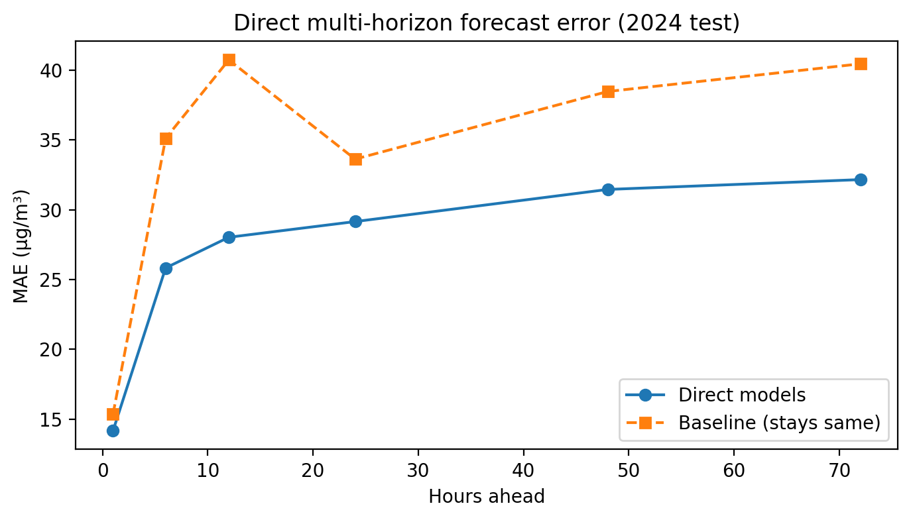
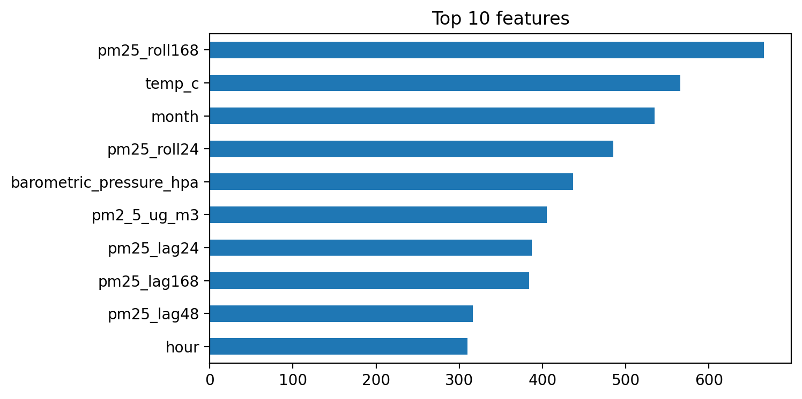
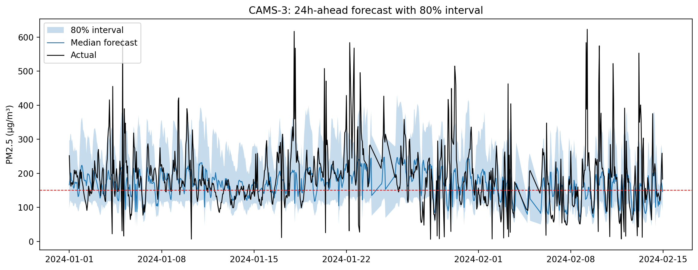
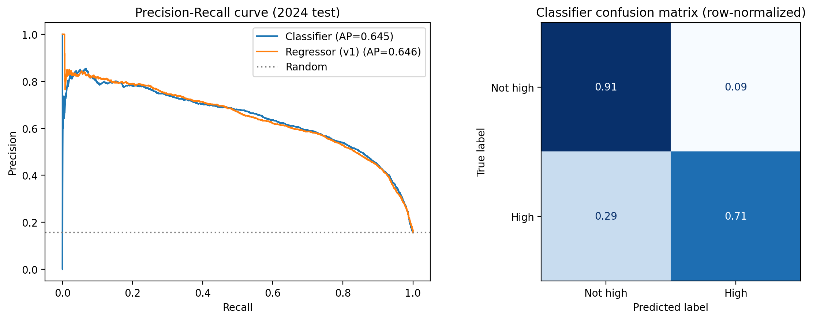
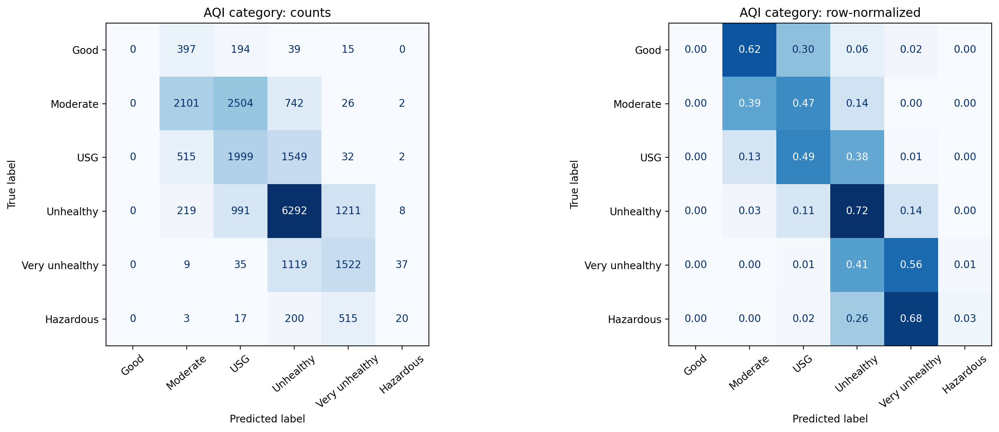
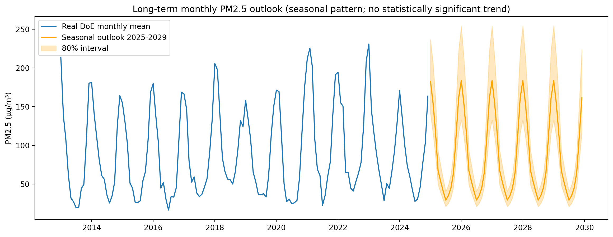

# Dhaka PM2.5 Air Quality Forecasting and Anomaly Detection System

[](https://www.python.org/)
[](https://lightgbm.readthedocs.io/)
[](https://opensource.org/licenses/MIT)
[](data/)
[]()

An end-to-end, operational-grade Machine Learning and Anomaly Detection system for hourly fine particulate matter ($\text{PM}_{2.5}$) forecasting across the megacity of **Dhaka, Bangladesh**.

The system utilizes a 15-year continuous observational record (2012–2026) across the three official Continuous Air Monitoring Stations (CAMS) operated by the Department of Environment (DoE), Government of Bangladesh. It delivers multivariate sensor anomaly screening, 24-hour and direct multi-horizon forecasting (1h to 72h), calibrated public health alerts for severe pollution episodes ($\text{PM}_{2.5} > 150\ \mu\text{g}/\text{m}^3$), 80% prediction interval uncertainty quantification, and macro-scale monthly trend projections.

---

## Table of Contents

- [1. Motivation & Problem Definition](#1-motivation--problem-definition)
- [2. System Architecture](#2-system-architecture)
- [3. Observational Network & Dataset](#3-observational-network--dataset)
- [4. Key Capabilities & Methodologies](#4-key-capabilities--methodologies)
  - [A. Data Cleaning & Timeline Regularization](#a-data-cleaning--timeline-regularization)
  - [B. Multi-Pollutant Anomaly Detection (Isolation Forest)](#b-multi-pollutant-anomaly-detection-isolation-forest)
  - [C. Spatial & Temporal Feature Engineering](#c-spatial--temporal-feature-engineering)
  - [D. Gradient Boosted Forecasting (LightGBM)](#d-gradient-boosted-forecasting-lightgbm)
  - [E. Direct Multi-Horizon Forecasting (1h to 72h)](#e-direct-multi-horizon-forecasting-1h-to-72h)
  - [F. Severe Episode Alert Classification & Threshold Optimization](#f-severe-episode-alert-classification--threshold-optimization)
  - [G. Quantile Regression & Uncertainty Bounds](#g-quantile-regression--uncertainty-bounds)
  - [H. Long-Term Trend & Seasonality (SARIMA)](#h-long-term-trend--seasonality-sarima)
- [5. Experimental Benchmarks & Evaluation](#5-experimental-benchmarks--evaluation)
- [6. Visualizations & Result Artifacts](#6-visualizations--result-artifacts)
- [7. Repository Structure](#7-repository-structure)
- [8. Installation & Setup](#8-installation--setup)
- [9. Quick Start Guide](#9-quick-start-guide)
- [10. Citation & License](#10-citation--license)

---

## 1. Motivation & Problem Definition

Dhaka is one of the most densely populated megacities on Earth (>20 million inhabitants) and routinely ranks among the world's most polluted urban centers according to WHO and AirVisual global rankings. During the post-monsoon and dry winter season (November to March), atmospheric temperature inversions trap brick-kiln emissions, vehicular exhaust, road dust, and transboundary aerosols in the planetary boundary layer. Ambient $\text{PM}_{2.5}$ regularly surpasses $250\ \mu\text{g}/\text{m}^3$—over 16 times the WHO 24-hour guideline of $15\ \mu\text{g}/\text{m}^3$.

Accurate short- and medium-term forecasting empowers:
1. **Public Health Advisory Systems**: Timely warnings for schools, vulnerable populations, and outdoor workers before hazardous smog settles.
2. **Municipal Intervention**: Dynamic traffic routing, industrial suspension, and water sprinkling on major arterial corridors.
3. **Sensor Network Reliability**: Automated real-time flagging of sensor failures, calibration drifts, stuck readings, and unphysical inversions.

---

## 2. System Architecture



---

## 3. Observational Network & Dataset

Observations originate from the Department of Environment (DoE) Continuous Air Monitoring Stations (CAMS) across Dhaka:

| Station ID | Station Name | Latitude / Longitude | Built Environment Context |
| :--- | :--- | :--- | :--- |
| **CAMS-1** | Paribesh Bhaban | 23.777° N, 90.380° E | DoE Headquarters, Agargaon. Institutional / urban background. |
| **CAMS-2** | Farmgate (BARC) | 23.754° N, 90.389° E | Bangladesh Agricultural Research Council. High-density commercial traffic. |
| **CAMS-3** | Darussalam (Mirpur) | 23.788° N, 90.353° E | Technical Mor, Mirpur. Major inter-district transit hub & industrial axis. |

### Dataset Partitioning (Strict Temporal Integrity)
To guarantee strict real-world generalization and prevent time-series data leakage:
- **Training Set (2013–2022)**: 161,740 valid hourly instances.
- **Validation Set (2023)**: 22,471 valid hourly instances (used for early stopping, PR threshold tuning, and hyperparameter CV).
- **Test Set (2024)**: 22,315 completely held-out hourly instances spanning all 3 stations.
- *(Note: Year 2012 has <15% coverage across stations and is excluded from training).*

---

## 4. Key Capabilities & Methodologies

### A. Data Cleaning & Timeline Regularization
- **Negative Removal**: Negative sensor voltages ($< 0$) from calibration drift are mapped to `NaN`.
- **Regular Grid Interpolation**: Missing gaps $\le 3$ hours are interpolated linearly along the time axis; all imputed rows are flagged with `is_imputed = True`. Gaps $> 3$ hours remain `NaN` to preserve autoregressive accuracy.
- **Physical Inversion Verification**: Identifies violations where fine particles exceed total suspended particles ($PM_{2.5} > PM_{10} + 10\ \mu\text{g}/\text{m}^3$).

### B. Multi-Pollutant Anomaly Detection (Isolation Forest)
An Isolation Forest model ($n=200$, contamination $= 0.01$) detects multivariate anomalies across co-located gases and aerosols ($\text{PM}_{2.5}$, $\text{PM}_{10}$, $\text{NO}_2$, $\text{CO}$). It differentiates genuine atmospheric episodes from instrument malfunctions (voltage spikes, stuck reading zero-variance plateaus).

### C. Spatial & Temporal Feature Engineering
- **Autoregressive Lags**: $[1, 2, 3, 6, 12, 24, 48, 168]$ hours.
- **Rolling Window Statistics**: Moving averages, standard deviations, and 24-hour min/max envelopes over 24h (diurnal) and 168h (weekly) windows.
- **Harmonic Encodings**: Continuous sinusoidal transformations:
  $$\sin\left(\frac{2\pi \cdot t}{T}\right),\quad \cos\left(\frac{2\pi \cdot t}{T}\right)$$
  for hour ($T=24$), day of week ($T=7$), month ($T=12$), and day of year ($T=365.25$).
- **Cross-Station Network Transport**: Contemporaneous pollutant readings from neighboring stations pivoted into the feature matrix, enabling the model to learn windborne transport across the city.
- **Dynamic Spike Differentials**: Rate of change ($\Delta_{1\text{h}} = y_t - y_{t-1}$, $\Delta_{24\text{h}} = y_t - y_{t-24}$) and ratio to 24h moving average.

### D. Gradient Boosted Forecasting (LightGBM)
Gradient Boosted Decision Trees trained with histogram-based binning, early stopping on validation loss, and Optuna Bayesian optimization:
- Model v1: Baseline 24h-ahead regressor (29 features).
- Model v2: Cross-station lags and $\log(1 + y)$ target transformation.
- Model v3 + Tuned: 46 expanded features with tree regularizers ($\lambda_{L2} = 0.1306$, $\alpha_{L1} = 0.1225$, $\text{num\_leaves} = 18$).

### E. Direct Multi-Horizon Forecasting (1h to 72h)
Instead of relying solely on error-accumulating recursive rollouts, dedicated direct models were trained for horizons $h \in \{1, 6, 12, 24, 48, 72\}$ hours. Every single model outperforms the persistence baseline ("stays same as now").

### F. Severe Episode Alert Classification & Threshold Optimization
A dedicated binary LightGBM classifier specifically targets dangerous episodes ($\text{PM}_{2.5} > 150\ \mu\text{g}/\text{m}^3$, EPA "Unhealthy"). To balance false alarms and public safety:
- Decision threshold was swept strictly on 2023 validation data.
- Optimal threshold ($p^* = 0.353$) maximizes $F_1$-score on validation and generalizes to the 2024 test set with **71.2% Recall** and **0.645 PR-AUC** (vs 0.157 random baseline).

### G. Quantile Regression & Uncertainty Bounds
Three pinball-loss models ($\alpha = 0.10, 0.50, 0.90$) generate an 80% prediction interval $[q_{10}, q_{90}]$:
- Achieved **79.2% empirical coverage** on the 2024 test benchmark (nominal: 80.0%).
- For risk-averse alerting, triggering alerts when the upper bound $q_{90} > 150\ \mu\text{g}/\text{m}^3$ successfully catches **91.3%** of all severe pollution hours.

### H. Long-Term Trend & Seasonality (SARIMA)
Monthly average aggregations requiring $\ge 200$ valid hours/month were evaluated with log-scale seasonal autoregressive integrated moving average (SARIMA) modeling:
- Empirical trend slope is $+1.41\ \mu\text{g}/\text{m}^3/\text{year}$ ($p = 0.189$, not statistically significant at 5% alpha), confirming that Dhaka's extreme winter air quality represents persistent, entrenched seasonal dynamics rather than a simple monotonic linear surge.

---

## 5. Experimental Benchmarks & Evaluation

All metrics below are evaluated on the **2024 held-out test set** (22,315 hourly samples):

### 24-Hour Ahead Point Forecast Performance

| Model Configuration | MAE ($\mu\text{g}/\text{m}^3$) | RMSE ($\mu\text{g}/\text{m}^3$) | $R^2$ Score | Notes |
| :--- | :---: | :---: | :---: | :--- |
| **Persistence Baseline** ($y_{t+24} \approx y_t$) | 33.52 | 57.93 | 0.342 | Naive standard baseline |
| **LightGBM v1 (Baseline)** | 29.35 | 47.85 | 0.554 | 29 features |
| **LightGBM v2 (Cross-Station + Log)** | 28.42 | 49.43 | 0.524 | Log-transformed target |
| **LightGBM v3 (Expanded Features)** | 29.18 | 47.63 | 0.558 | 46 features |
| **LightGBM v3 + Optuna Tuned** | **29.17** | **47.66** | **0.557** | **Best balanced model** |

> **Net Performance Gain**: LightGBM reduces MAE by **$4.35\ \mu\text{g}/\text{m}^3$ (-13.0%)** and RMSE by **$10.27\ \mu\text{g}/\text{m}^3$ (-17.7%)** compared to persistence.

### Per-Station Accuracy Breakdown (2024 Test Set)

| Station Code | Station Name | Test Samples | MAE ($\mu\text{g}/\text{m}^3$) | RMSE ($\mu\text{g}/\text{m}^3$) | $R^2$ Score |
| :--- | :--- | :---: | :---: | :---: | :---: |
| **CAMS-1** | Paribesh Bhaban (Agargaon) | 7,584 | 29.59 | 46.49 | 0.561 |
| **CAMS-2** | Farmgate (BARC) | 7,893 | 23.94 | 37.56 | 0.569 |
| **CAMS-3** | Darussalam (Mirpur) | 6,838 | 35.32 | 58.70 | 0.519 |

### Direct Multi-Horizon Forecast Horizon Accuracy

| Horizon ($h$) | Model MAE ($\mu\text{g}/\text{m}^3$) | Persistence MAE ($\mu\text{g}/\text{m}^3$) | Improvement over Persistence |
| :---: | :---: | :---: | :---: |
| **1 hour** | 14.15 | 15.34 | **+7.7%** |
| **6 hours** | 25.83 | 35.11 | **+26.4%** |
| **12 hours** | 28.02 | 40.73 | **+31.2%** |
| **24 hours** | 29.15 | 33.62 | **+13.3%** |
| **48 hours** | 31.45 | 38.47 | **+18.2%** |
| **72 hours** | 32.16 | 40.45 | **+20.5%** |

### Severe Episode Alerting Performance ($\text{PM}_{2.5} > 150\ \mu\text{g}/\text{m}^3$)

| Strategy / Model | Recall (Catch Rate) | Precision | $F_1$-Score | False Alarms | PR-AUC |
| :--- | :---: | :---: | :---: | :---: | :---: |
| Random Guessing Baseline | 15.7% | 15.7% | 0.157 | — | 0.157 |
| Point Regressor ($\hat{y} > 150$) | 60.5% | 61.8% | 0.612 | 1,307 | 0.646 |
| **Dedicated Classifier ($p > 0.353$)** | **71.2%** | **58.8%** | **0.644** | 1,749 | **0.645** |
| Upper Quantile Bound ($q_{90} > 150$) | **91.3%** | 42.1% | 0.576 | 4,356 | — |

---

## 6. Visualizations & Result Artifacts

All figures are generated directly from the experimental pipeline and stored in `results/`:

| Time Series Forecast (2024 Test Set) | Predicted vs Actual Scatter Plot |
| :---: | :---: |
|  |  |
| *Actual vs Predicted 24h PM2.5 tracking diurnal dynamics* | *$R^2 = 0.557$ alignment against ground truth* |

| Multi-Horizon Performance (1h to 72h) | Feature Importance |
| :---: | :---: |
|  |  |
| *Direct LightGBM error progression vs persistence* | *Top predictors: 168h rolling mean, temp, lag1* |

| Quantile 80% Prediction Band | Severe Event Precision-Recall Curve |
| :---: | :---: |
|  |  |
| *79.2% empirical coverage across extreme surges* | *PR-AUC = 0.645 vs 0.157 random baseline* |

| 6-Class AQI Confusion Matrix | Long-Term Outlook (2025–2029) |
| :---: | :---: |
|  |  |
| *Categorical evaluation across EPA/DoE AQI tiers* | *Historical monthly means and SARIMA projection* |

---

## 7. Repository Structure

```
dhaka-pm25-forecasting/
├── README.md                      # Comprehensive project documentation
├── LICENSE                        # MIT License
├── requirements.txt               # Pinned Python package dependencies
├── data/
│   ├── README.md                  # Dataset metadata, column schema & statistics
│   └── dhaka_cams_hourly_2012_2026.csv  # 15-year hourly CAMS observation dataset (~38 MB)
├── notebooks/
│   ├── README.md                  # Notebook step-by-step workflow guide
│   └── ML_Lab_improved.ipynb      # Complete 25-step research & training notebook
├── models/
│   ├── README.md                  # Model documentation & deserialization guide
│   ├── pm25_lgbm.txt              # Serialized baseline LightGBM Booster
│   └── pm25_lgbm_tuned.txt        # Serialized Optuna-tuned LightGBM Booster
├── results/
│   ├── README.md                  # Result catalog and CSV descriptions
│   ├── results.zip                # Archived zip containing all figures and CSVs
│   ├── fig_forecast.png           # Actual vs Predicted time-series plot
│   ├── fig_scatter.png            # Actual vs Predicted scatter correlation
│   ├── fig_direct_horizon.png     # Horizon error comparison (1h to 72h)
│   ├── fig_error_vs_horizon.png   # Error saturation curve
│   ├── fig_importance.png         # LightGBM feature importance rankings
│   ├── fig_pr_classifier.png      # Precision-Recall curve for severe events
│   ├── fig_confusion_binary.png   # Binary confusion matrix (> 150 µg/m³)
│   ├── fig_confusion_aqi.png      # 6-class AQI tier confusion matrix
│   ├── fig_quantile_band.png      # 80% quantile prediction intervals
│   ├── fig_longterm_forecast.png  # SARIMA monthly projections through 2029
│   ├── anomalies.csv              # Detected multivariate sensor anomalies
│   ├── forecast_results_2024.csv  # 2024 test benchmark predictions
│   └── longterm_forecast_2025_2029.csv  # 2025–2029 monthly forecasts
└── src/
    ├── __init__.py                # Package exports
    ├── README.md                  # Source code module documentation
    ├── data_loader.py             # Ingestion, negative filtering & interpolation
    ├── anomaly_detection.py       # Isolation Forest & physical consistency checks
    ├── features.py                # Lag, rolling, harmonic & cross-station features
    ├── models.py                  # LightGBM training, quantiles & classifier
    ├── evaluate.py                # Regression metrics, AQI mapping & alert benchmarks
    └── predict.py                 # 24h prediction, 72h rollout & staleness checks
```

---

## 8. Installation & Setup

### Prerequisites
- Python 3.9, 3.10, 3.11, 3.12, 3.13, or 3.14
- Git (and optional Git LFS)

### Clone & Install
```bash
# 1. Clone the repository
git clone https://github.com/Hemal0651/dhaka-pm25-forecasting.git
cd dhaka-pm25-forecasting

# 2. Create and activate a virtual environment
python -m venv .venv

# On Linux/macOS:
source .venv/bin/activate
# On Windows (PowerShell):
.venv\Scripts\Activate.ps1

# 3. Install dependencies
pip install -r requirements.txt
```

---

## 9. Quick Start Guide

### Option 1: Load Pre-Trained Model & Predict

```python
import lightgbm as lgb
import pandas as pd
from src.features import engineer_features, get_feature_columns
from src.predict import forecast_next_24h, check_data_staleness

# 1. Load serialized Optuna-tuned model
booster = lgb.Booster(model_file="models/pm25_lgbm_tuned.txt")

# 2. Load recent observations
df = pd.read_csv("data/dhaka_cams_hourly_2012_2026.csv", parse_dates=["timestamp"])

# 3. Check station sensor staleness
status = check_data_staleness(df[df["station_id"] == "CAMS-2"])
print(f"Station status: {status['reason']}")

# 4. Generate features and forecast
featured = engineer_features(df)
feature_names = booster.feature_name()
latest_row = featured[featured["station_id"] == "CAMS-2"].iloc[[-1]]

forecast = forecast_next_24h(booster, latest_row, feature_names)
print(f"24h Predicted PM2.5: {forecast['forecast_pm25_ug_m3']} µg/m³")
print(f"Forecast AQI Category: {forecast['aqi_category']}")
```

### Option 2: Run End-to-End Notebook

Launch Jupyter and run `notebooks/ML_Lab_improved.ipynb`:
```bash
jupyter notebook notebooks/ML_Lab_improved.ipynb
```

---

## 10. Citation & License

### License
This project is open-source under the [MIT License](LICENSE).

### Acknowledgements
We gratefully acknowledge the **Department of Environment (DoE)**, Ministry of Environment, Forest and Climate Change, Government of Bangladesh, and the World Bank **Clean Air and Sustainable Environment (CASE)** project for establishing and maintaining the CAMS network in Dhaka.

### Author
- **Hemal Fahim** ([GitHub: @Hemal0651](https://github.com/Hemal0651))
